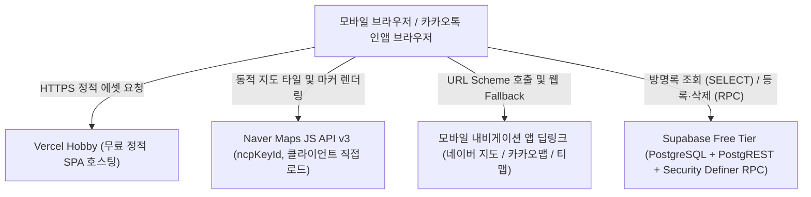

# May Wedding — 모바일 청첩장 기술 및 디자인 명세서 (`spec.md`)

> **프로젝트명:** `may-wedding` (2027년 5월 셀프 모바일 청첩장)  
> **디자인 컨셉:** '데어무드(Theirmood)' 풍 미니멀 에디토리얼 (Minimal Editorial)  
> **운영 목표:** 100% 무료 호스팅·DB·API 기반의 감각적이고 가벼운 모바일 웹 청첩장 구축

---

## 1. 문서 개요 및 프로젝트 비전 (Project Overview)

### 1.1 프로젝트 목적
기성 외주 모바일 청첩장 업체의 천편일률적인 템플릿, 과도한 배너/광고성 UI, 불필요한 부가 기능을 탈피하고, 2027년 5월 결혼식에 맞춰 직접 설계·개발·운영하는 셀프 모바일 청첩장 프로젝트입니다.

### 1.2 디자인 지향점 — 미니멀 에디토리얼
- **잡지 화보 같은 여백과 비율:** 장식적 요소를 덜어내고 스냅 사진, 타이포그래피, 여백의 리듬감만으로 분위기를 전달합니다.
- **정제된 타이포그래피:** 영문 세리프(`Cormorant Garamond`)와 단정한 국문 세리프(`Gowun Batang`), 가독성 높은 UI 산세리프(`Pretendard`)의 조화로 에디토리얼 톤을 완성합니다.
- **따뜻한 뉴트럴 팔레트:** 순백(`#FFFFFF`)이나 원색 대신 따뜻한 아이보리(`#FAF8F5`)와 린넨·스톤 톤(`#F3EFEA`, `#E5DFD7`), 딥 에스프레소 텍스트(`#23211F`)를 사용합니다.
- **절제된 인터랙션:** 스크롤 방해 없는 부드러운 전환과 필요한 순간에만 작동하는 직관적 피드백(토스트, 딥링크, 방명록 컨페티)을 제공합니다.

### 1.3 핵심 원칙 및 의도적 제외 항목 (Non-Goals)
100% 무료 유지와 미니멀리즘을 위해 아래 항목은 설계 단계에서 명시적으로 제외합니다.

| 구분 | 포함 원칙 (In-Scope) | 의도적 제외 항목 (Non-Goals) |
| :--- | :--- | :--- |
| **비용** | Vercel Hobby, Supabase Free, NCP 무료 할당량 등 **100% 무료 티어만 사용** | 유료 API(유료 SMS 알림, 유료 카카오/네이버 유료 플랜 등), 유료 호스팅/스토리지 |
| **오디오/연락** | 담백한 텍스트 안내 및 1회성 계좌/주소 복사 | **BGM 오디오 플레이어 제외**, **전화/문자(`tel:` / `sms:`) 버튼 제외** |
| **시각 효과** | 절제된 Fade-Up 및 방명록 등록 시 뉴트럴 톤 컨페티 | 화면 전체에 상시 떨어지는 꽃잎/눈/반짝이 애니메이션 |
| **기능 범위** | 정적 안내 + 실시간 방명록 + 지도/내비 딥링크 + 계좌 복사 | RSVP 참석 여부 설문, 방명록 수정(삭제 후 재작성으로 단순화), 화환/선물하기 외부 링크 |

---

## 2. 비용·호스팅 및 인프라 아키텍처 (Cost & Hosting Architecture)

### 2.1 시스템 아키텍처



### 2.2 환경 변수 규격 (`.env.example` / Vercel Environment Variables)
모든 민감 정보 또는 프로젝트 식별자는 Vite 클라이언트 환경 변수 접두사(`VITE_`)로 관리하며, `.env.local`은 `.gitignore`에 등록하여 저장소에 커밋하지 않습니다.

```env
VITE_SUPABASE_URL=https://your-project-id.supabase.co
VITE_SUPABASE_ANON_KEY=your-supabase-anon-key
VITE_NAVER_MAP_CLIENT_ID=your-ncp-maps-client-id
```

> **주의:** `VITE_*` 변수는 빌드 번들에 포함되어 브라우저에 노출됩니다. 따라서 Supabase는 반드시 **RLS(Row Level Security)**와 **컬럼 권한 제한 + `SECURITY DEFINER` RPC**로 보호하고, Naver Map Client ID는 **Web 서비스 URL 화이트리스트**로 보호해야 합니다.

### 2.3 무료 티어 운영 가드레일

1. **Vercel Hobby (무료 티어)**
   - 정적 Vite SPA(`dist/`) 배포, 자동 HTTPS 및 `main` 브랜치 푸시 기반 자동 배포.
   - 무료 대역폭(Fast Data Transfer) 절약을 위해 모든 커버/갤러리 사진은 사전 리사이즈(가로 1200px 이하) 및 WebP 포맷으로 최적화하여 저장합니다.
2. **Supabase Free (무료 티어)**
   - PostgreSQL 500MB, 월 50,000 MAU 수준 무료 제공.
   - **7일 미사용 자동 일시정지(Auto-pause) 주의:** Supabase 무료 프로젝트는 7일간 API 트래픽이 없으면 일시정지됩니다. 청첩장 발송 약 2주 전부터 예식 직후까지는 GitHub Actions 스케줄 워크플로우(예: 4~5일마다 `guestbook` 경량 `HEAD/GET` 헬스체크)를 두거나, 발송 전 Supabase 대시보드에서 프로젝트 활성(Active) 상태를 반드시 확인합니다.
3. **Naver Cloud Platform (무료 할당량 — Dynamic Map)**
   - NCP 콘솔(`Services > Application Services > Maps`)에서 **Web Dynamic Map**을 선택하여 애플리케이션을 등록하고 발급받은 Client ID를 `ncpKeyId` 파라미터로 전달합니다.
   - **대표 계정(Primary Account) 정책:** NCP Maps 무료 할당량은 본인 인증된 **대표 계정 1개**에만 적용됩니다(서브/추가 계정은 첫 호출부터 과금될 수 있음). 반드시 대표 계정을 확인합니다.
   - **도메인(Web 서비스 URL) 등록:** `http://localhost:5173`, `https://<project>.vercel.app`, 커스텀 도메인(있는 경우)을 정확히 등록합니다. 누락 시 인증 실패/Referer 오류가 발생합니다.
   - **과금 원천 차단:** 애플리케이션 설정에서 **한도 및 알림 설정(Usage Limits & Notifications)**을 활성화하여 무료 할당량 초과 시 자동 차단 또는 즉시 알림이 오도록 구성합니다.

### 2.4 카카오톡 및 SNS 공유 Open Graph (OG) 메타 규격
모바일 청첩장은 대부분 카카오톡 채팅방으로 공유되므로 `index.html`에 아래 메타 태그를 필수 적용합니다.

```html
<meta property="og:type" content="website" />
<meta property="og:title" content="민준 & 서연 결혼합니다" />
<meta property="og:description" content="2027년 5월 22일 토요일 오후 2시 · 예식장 이름" />
<meta property="og:image" content="https://your-domain.vercel.app/og-image.jpg" />
<meta property="og:image:width" content="1200" />
<meta property="og:image:height" content="630" />
<meta property="og:url" content="https://your-domain.vercel.app/" />
```

- **이미지 권장 사양:** `public/og-image.jpg` (1200×630 또는 800×400, **300KB 이하**, JPEG 포맷 권장 — 일부 메신저에서 WebP OG 이미지 미지원 대비).
- **캐시 초기화:** 배포 후 타이틀·썸네일을 수정했다면 [카카오 공유 디버거(Sharing Debugger)](https://developers.kakao.com/tool/debugger/sharing)에서 URL 캐시를 수동 초기화합니다.

---

## 3. 기술 스택 및 모바일 뷰포트 전략 (Tech Stack & Mobile Viewport)

### 3.1 기술 스택

| 영역 | 기술 및 라이브러리 | 선정 사유 및 비고 |
| :--- | :--- | :--- |
| **Build & Core** | `Vite`, `React 18+`, `TypeScript 5+` | 빠른 정적 번들링, 엄격한 타입 안정성 |
| **Styling** | `Tailwind CSS` (v4 `@tailwindcss/vite` 권장) | 유틸리티 기반 일관된 디자인 토큰 및 간격 제어 |
| **Icons & FX** | `lucide-react`, `canvas-confetti` (`@types/canvas-confetti`) | 가벼운 선형 아이콘, 방명록 등록 축하 컨페티 |
| **Database Client** | `@supabase/supabase-js` | 무료 PostgreSQL 방명록 조회 및 보안 RPC 호출 |
| **Map SDK** | Naver Maps JavaScript API v3 (`https://oapi.map.naver.com/openapi/v3/maps.js?ncpKeyId=...`) | 국내 웨딩홀 검색·마커 가독성 최적화 |

### 3.2 모바일 뷰포트 최적화 규칙
데스크톱·태블릿·모바일·인앱 브라우저 전반에서 동일한 에디토리얼 비율을 유지합니다.

- **중앙 모바일 프레임 레이아웃:**
  - 루트 뷰포트 배경: `bg-[#EFECE6]` (데스크톱에서 좌우 여백을 채우는 톤)
  - 메인 청첩장 컨테이너: `w-full max-w-md mx-auto min-h-dvh bg-[#FAF8F5] shadow-[0_0_40px_rgba(35,33,31,0.06)] overflow-x-hidden relative`
- **Dynamic Viewport (`dvh`) 전면 적용:**
  - `100vh` 대신 `h-dvh` / `min-h-dvh`를 사용하여 iOS Safari 및 카카오톡 인앱 브라우저에서 상·하단 툴바가 숨겨지거나 나타날 때 커버 영역이 잘리거나 점프하는 현상을 방지합니다.
- **모바일 브라우저 UX 가드레일:**
  - **Safe Area 대응:** 하단 고정 토스트 및 푸터 하단에 `pb-[calc(1.5rem+env(safe-area-inset-bottom))]` 반영.
  - **iOS 입력창 자동 줌 방지:** 모든 `<input>`, `<textarea>` 폰트 크기를 최소 `16px`(`text-[16px]`) 이상으로 유지.
  - **텍스트 크기 자동 보정 방지:** `html { -webkit-text-size-adjust: 100%; }` 적용.
  - **터치/이미지 UX:** 사진 장시간 누르기/드래그 방지를 위해 필요 영역에 `select-none`, `-webkit-touch-callout: none` 적용.

### 3.3 프로젝트 디렉터리 구조

```text
may-wedding/
├── public/
│   ├── og-image.jpg                # SNS/카카오톡 공유용 썸네일 (<= 300KB)
│   └── images/
│       ├── cover.webp              # 커버 풀화면 스냅 사진
│       └── gallery-01.webp ...     # 갤러리 화보 이미지
├── supabase/
│   └── schema.sql                  # Supabase DDL, RLS 정책, Security Definer RPC
├── src/
│   ├── data/
│   │   └── weddingConfig.ts        # 모든 텍스트, 날짜, 계좌, 좌표, 타임라인 단일 관리
│   ├── lib/
│   │   ├── supabase.ts             # Supabase 클라이언트 초기화 및 방명록 API 래퍼
│   │   ├── clipboard.ts            # Clipboard API + 구형/인앱 브라우저 execCommand Fallback
│   │   ├── mapLinks.ts             # 네이버지도 / 카카오맵 / 티맵 딥링크 및 Fallback 처리
│   │   └── date.ts                 # KST(Asia/Seoul) 기준 D-Day 및 5월 달력 계산 유틸
│   ├── context/
│   │   └── ToastContext.tsx        # 전역 하단 플로팅 토스트 상태 관리
│   ├── components/
│   │   ├── Cover.tsx               # 풀화면 커버 + 영문 세리프 오버레이
│   │   ├── Greeting.tsx            # 모시는 글 + 양가 부모/신랑신부 성함
│   │   ├── CalendarSection.tsx     # 가로폭 75% 미니멀 달력 + 실시간 KST D-Day 바
│   │   ├── Timeline.tsx            # 웰컴 리셉션 / 본식 / 연회장 식사 버티컬 타임라인
│   │   ├── Gallery.tsx             # 인스타그램 스타일 가로 스와이프 캐러셀
│   │   ├── GalleryModal.tsx        # 클릭 시 풀스크린 라이트박스 모달
│   │   ├── Location.tsx            # 식장 주소 복사 + 3종 내비 버튼 + 교통 안내
│   │   ├── NaverMap.tsx            # 네이버 지도 Web SDK 래퍼 + 드래그 잠금/Fallback
│   │   ├── Guestbook.tsx           # 실시간 방명록 목록 및 작성 폼 + 컨페티
│   │   ├── GuestbookDeleteModal.tsx# 4자리 PIN 확인 삭제 모달
│   │   ├── Account.tsx             # [마음 전하실 곳] 아코디언 + 계좌 복사
│   │   ├── Footer.tsx              # 에디토리얼 맺음말 및 크레딧
│   │   └── ToastContainer.tsx      # 하단 플로팅 토스트 UI
│   ├── App.tsx
│   ├── main.tsx
│   └── index.css
├── .env.example
├── index.html
├── package.json
└── spec.md
```

---

## 4. 디자인 시스템 — 데어무드(Theirmood) 미니멀 에디토리얼

### 4.1 컬러 팔레트

| 토큰 역할 | Hex | 명칭 / 설명 | 주요 사용처 |
| :--- | :--- | :--- | :--- |
| **Outer Backdrop** | `#EFECE6` | Warm Sand | 데스크톱 뷰포트 좌우 바깥 배경 |
| **Canvas Primary** | `#FAF8F5` | Warm Ivory | 청첩장 기본 섹션 배경 |
| **Surface Secondary** | `#F3EFEA` | Soft Linen | 교차 섹션 배경, 카드, 인풋/아코디언 표면 |
| **Border / Hairline** | `#E5DFD7` | Warm Stone | 1px 헤어라인 구분선, 카드 보더 |
| **Text Primary** | `#23211F` | Deep Espresso Charcoal | 본문 제목, 이름, 핵심 정보 |
| **Text Secondary** | `#76706A` | Warm Taupe | 섹션 Eyebrow, 부연 설명, 타임라인 안내 |
| **Accent Primary** | `#9E6B64` | Muted Rose Clay | 달력 예식일 하트/닷, 일요일/포인트 강조 |
| **Accent Secondary** | `#8E7F72` | Warm Taupe Bronze | 보조 아이콘, 활성 도트 인디케이터 |

### 4.2 타이포그래피 계층
- **영문 디스플레이 세리프 (`Cormorant Garamond`, Google Fonts `300;400;500` + Italic)**
  - 커버 날짜·영문 성함, 섹션 상단 영문 Eyebrow(`INVITATION`, `CALENDAR`, `TIMELINE`, `GALLERY`, `LOCATION`, `GUESTBOOK`, `ACCOUNT`), 달력 월·일 숫자.
- **국문 에디토리얼 세리프 (`Gowun Batang`, Google Fonts `400;700`)**
  - 모시는 글 본문, 양가 부모님 및 신랑·신부 성함, 섹션 국문 타이틀, 맺음말.
- **국문 UI 산세리프 (`Pretendard`, jsDelivr CDN)**
  - 도로명 주소, 계좌번호, 타임라인 세부 안내, 내비게이션 버튼, 방명록 입력 폼 및 메시지, 하단 토스트 (`tabular-nums` 병행).

### 4.3 섹션 리듬, 구분선 및 모션 원칙
- **여백 리듬:** 각 섹션은 `py-20 px-6`을 기본으로 하여 숨 쉴 수 있는 화보형 여백을 유지합니다.
- **공통 Eyebrow 스타일:** `font-serif-en text-[11px] uppercase tracking-[0.22em] text-[#76706A]`
- **Hairline 구분선:** 섹션 간 경계는 그림자 대신 `w-12 h-px bg-[#E5DFD7] mx-auto` 또는 풀폭 `h-px bg-[#E5DFD7]`를 사용합니다.
- **스크롤 모션:** `IntersectionObserver`로 각 섹션 진입 시 1회만 은은한 Fade-Up (`opacity: 0 → 1`, `translateY(12px → 0)`, `duration: 700ms`)을 실행하며, OS 설정 `prefers-reduced-motion: reduce` 시 모션을 비활성화합니다.
- **컨페티 팔레트:** `canvas-confetti` 기본 원색 대신 에디토리얼 무드를 해치지 않는 뉴트럴 톤(`['#D9C5B2', '#B89F8D', '#E8DDD3', '#9E6B64', '#8E7F72']`)을 지정합니다.

---

## 5. 핵심 컴포넌트 상세 명세

### 5.1 Cover (`Cover.tsx`)
- **레이아웃:** `relative w-full h-dvh min-h-[580px] overflow-hidden` 풀블리드 스냅 사진(`object-cover w-full h-full`).
- **가독성 스크림:** 상단과 하단에 은은한 다크 그라데이션 오버레이(`bg-gradient-to-b from-black/35 via-transparent to-black/55`)를 배치하여 밝은 사진 위에서도 텍스트 대비를 확보합니다.
- **영문 세리프 오버레이:**
  - 상단: 예식 날짜(`2027. 05. 22`) 및 영문 서브 라벨(`SATURDAY, MAY 2027`)
  - 중앙/하단: 신랑·신부 영문 세리프 이름(`MINJUN & SEOYEON`) + 국문 성함, 예식 시간 및 웨딩홀 명칭
  - 최하단: 절제된 스크롤 유도 아이콘/텍스트 (`ChevronDown`)
- **성능:** 첫 화면 LCP(Largest Contentful Paint) 최적화를 위해 `fetchPriority="high"`, `loading="eager"`, WebP 포맷을 사용합니다.

### 5.2 Greeting (`Greeting.tsx`)
- **모시는 글:** 행간이 넓은(`leading-[2.1]`) 국문 세리프(`Gowun Batang`) 단락 배치, 좌우 여백을 넉넉히 두어 편지글처럼 읽히도록 구성합니다.
- **가족 관계 표기:** 정갈한 2행 정렬로 양가 부모님 성함과 관계를 표기합니다.
  - 예: `김철수 · 이영희` `의 장남` **`민준`**
  - 예: `박영수 · 최미영` `의 장녀` **`서연`**
  - `isDeceased?: boolean` 옵션 지원(고인 표기 `故` 또는 국화 심볼 선택 가능).
- **제약 준수:** 전화 걸기 / 문자 보내기 버튼을 일절 두지 않습니다.

### 5.3 Compact Calendar & D-Day (`CalendarSection.tsx`)
- **가로폭 75% 미니멀 달력 (`w-[75%] mx-auto`):**
  - 모바일 화면을 과도하게 점유하지 않도록 컴팩트한 비율로 렌더링합니다.
  - 상단 영문 월/연도(`May 2027` — `Cormorant Garamond`) + 일시 요약(`2027년 5월 22일 토요일 오후 2시`).
  - `grid-cols-7` 구조: 요일 헤더(`S M T W T F S`), 시작 요일 오프셋(2027년 5월 1일은 토요일이므로 앞 6칸 비움) 자동 계산.
  - 일요일은 뮤트 로즈(`#9E6B64`) 톤으로 은은하게 구분하고, 예식일(`22`)에는 작은 하트(`Heart` 아이콘) 또는 원형 닷 배지를 겹쳐 마킹합니다.
- **D-Day 실시간 계산 텍스트 바:**
  - **반드시 한국 표준시(KST, `Asia/Seoul`, UTC+9) 기준으로 날짜 차이를 계산**하여 해외 체류 하객이나 기기 타임존 차이로 인한 하루 오차를 방지합니다.
  - 상태별 문구 분기:
    - 예식 전 (`diff > 0`): `민준 ♥ 서연의 결혼식이 {N}일 남았습니다`
    - 예식 당일 (`diff === 0`): `오늘, 두 사람의 결혼식이 진행됩니다`
    - 예식 후 (`diff < 0`): `결혼식으로부터 {N}일이 지났습니다 · 함께해 주셔서 감사합니다`

### 5.4 Timeline (`Timeline.tsx`)
- **버티컬 타임라인 UI:** `weddingConfig.timeline` 배열 기반으로 렌더링하며 기본 3단계(`웰컴 리셉션`, `본식`, `연회장 식사`)를 제공합니다.
- **구조:** 좌측 1px 수직 연결선(`bg-[#E5DFD7]`) + 각 단계의 미니멀 원형 노드(`w-2.5 h-2.5 rounded-full`), 우측 시간(`13:30`, `tabular-nums`) + 항목 제목 + 장소/짧은 안내.
- **확장성:** 항목 추가/수정/문구 변경이 `weddingConfig.ts` 수정만으로 반영됩니다.

### 5.5 Gallery (`Gallery.tsx` & `GalleryModal.tsx`)
- **인스타그램 스타일 가로 스와이프 캐러셀:**
  - CSS Scroll Snap(`flex overflow-x-auto snap-x snap-mandatory scrollbar-none`)으로 네이티브 수준의 부드러운 터치 스와이프 구현.
  - 이미지 비율은 `aspect-[4/5]` 또는 `aspect-[3/4]`로 통일하고 `snap-center`로 정렬합니다.
  - 데스크톱/트랙패드 사용자를 위한 좌·우 미니멀 화살표 버튼을 오버레이합니다.
  - 하단에 **도트 인디케이터**와 **현재 인덱스(`1 / N`)**를 함께 표시하여 전체 장수를 직관적으로 인지시킵니다.
- **모달 라이트박스 (`GalleryModal.tsx`):**
  - 슬라이드 이미지 클릭 시 풀스크린 다크 백드롭(`bg-[#23211F]/95`) 라이트박스가 열립니다.
  - 좌/우 터치 스와이프, 이전/다음 버튼, 키보드(`ArrowLeft`, `ArrowRight`, `Escape`) 탐색, 닫기(`X`) 버튼을 지원합니다.
  - 모달이 열린 동안 `document.body.style.overflow = 'hidden'`으로 배경 스크롤을 잠급니다.
- **성능 최적화:** 첫 2장(`index < 2`)을 제외한 나머지 이미지는 `loading="lazy"`를 적용합니다.

### 5.6 Location & Navigation (`Location.tsx` & `NaverMap.tsx`)
- **식장 정보 및 원클릭 주소 복사:**
  - 웨딩홀 이름, 층/홀 정보, 도로명 주소 표기 + `[주소 복사]` 버튼 클릭 시 `copyToClipboard` 실행 후 Global Toast(`식장 주소가 복사되었습니다`) 표시.
- **Naver Map Web SDK (`NaverMap.tsx`):**
  - `VITE_NAVER_MAP_CLIENT_ID`를 사용하여 `https://oapi.map.naver.com/openapi/v3/maps.js?ncpKeyId=${clientId}` 스크립트를 동적으로 1회 로드합니다.
  - 예식장 좌표(`lat`, `lng`) 중심에 줌 레벨(기본 16)과 커스텀/기본 마커를 표시합니다.
  - **모바일 스크롤 간섭 방지:** 페이지 스크롤 중 지도가 의도치 않게 패닝되는 것을 막기 위해 기본 상태를 지도 잠금(`draggable: false, scrollWheel: false, pinchZoom: false`)으로 두고 우측 상단 `[지도 잠금 해제]` 토글 버튼을 제공합니다.
  - **Fallback UI:** SDK 로드 실패(네트워크 차단, 도메인 미등록, 환경변수 미설정) 시 깨진 빈 화면 대신 예식장 이름, 주소, 앱 길찾기 안내 카드를 표시합니다.
- **3종 내비게이션 앱 딥링크 버튼 (`[네이버 지도]`, `[카카오맵]`, `[티맵]`):**
  - 버튼 클릭 시 모바일 앱 URL Scheme을 우선 실행하고, `visibilitychange` + 1500ms 타이머 패턴으로 앱 미설치 시 웹 Fallback으로 전환합니다.
  - 각 앱별 규격 (`mapLinks.ts`):
    - **네이버 지도:**
      - 앱 Scheme: `nmap://place?lat=${lat}&lng=${lng}&name=${encodeURIComponent(name)}&appname=${encodeURIComponent(origin)}`
      - 웹 Fallback: `naverPlaceId`가 있으면 `https://map.naver.com/p/entry/place/${naverPlaceId}`, 없으면 `https://map.naver.com/p/search/${encodeURIComponent(address)}`
    - **카카오맵:**
      - 앱 Scheme: `kakaoPlaceId`가 있으면 `kakaomap://place?id=${kakaoPlaceId}`, 없으면 `kakaomap://look?p=${lat},${lng}`
      - 웹 Fallback: `https://map.kakao.com/link/map/${encodeURIComponent(name)},${lat},${lng}`
    - **티맵 (TMAP):**
      - 앱 Scheme: `tmap://route?goalname=${encodeURIComponent(name)}&goalx=${lng}&goaly=${lat}`
      - **좌표 순서 주의:** 티맵은 `goalx`가 **경도(`lng`)**, `goaly`가 **위도(`lat`)**입니다(반대로 입력 시 위치 오류 발생).
      - Fallback: 데스크톱 환경에서는 `"티맵 길찾기는 모바일 기기에서 이용 가능합니다"` Global Toast를 띄우고, 모바일 미설치 시 OS에 따라 App Store / Google Play 스토어 링크로 안내합니다.
- **교통편 및 주차 안내:** 지하철, 버스, 자가용/주차(무료 주차 시간, 발렛 여부 등) 항목을 깔끔한 리스트로 제공합니다.

### 5.7 Guestbook (`Guestbook.tsx` & `GuestbookDeleteModal.tsx`)
- **방명록 조회:**
  - 최신순(`created_at DESC`)으로 페이지당 **6건**씩 로드하며, 추가 데이터가 있을 때 `[더 보기]` 버튼을 노출합니다.
  - React 기본 이스케이프 렌더링을 유지하고 `dangerouslySetInnerHTML` 사용을 금지하여 XSS를 방지합니다.
- **축하 메시지 작성 폼:**
  - 필드: 작성자 이름(1~20자), 축하 메시지(1~300자, 실시간 글자수 카운터 `0 / 300`), 삭제용 비밀번호(숫자 4자리 PIN: `type="password"`, `inputMode="numeric"`, `pattern="[0-9]*"`, `maxLength={4}`, `autoComplete="off"`).
  - 제출 중(`isSubmitting`) 버튼 비활성화로 중복 등록을 방지합니다.
  - `supabase.rpc('add_guestbook_entry', { p_author_name, p_message, p_pin })` 호출 성공 시:
    1. 반환된 새 레코드를 목록 최상단에 즉시 추가
    2. 입력 폼 초기화
    3. 에디토리얼 뉴트럴 톤 `canvas-confetti` 발사
    4. Global Toast 표시 (`"축하 메시지가 등록되었습니다"`)
- **4자리 PIN 기반 본인 글 삭제 (`GuestbookDeleteModal.tsx`):**
  - 각 방명록 카드 우측 상단 삭제(`Trash2` 또는 `X`) 아이콘 클릭 시 PIN 입력 모달 오픈.
  - 4자리 숫자 입력 후 `[삭제하기]` 클릭 → `supabase.rpc('delete_guestbook_entry', { p_id, p_pin })` 호출.
  - 반환값이 `true`이면 해당 항목을 로컬 목록에서 즉시 제거하고 모달을 닫은 뒤 Global Toast 표시 (`"방명록이 삭제되었습니다"`).
  - 반환값이 `false`이면 모달 내 에러 문구(`"비밀번호가 일치하지 않습니다"`)를 표시합니다.

### 5.8 Account (`Account.tsx`)
- **UI 구조:** `[마음 전하실 곳]` 섹션 헤더 및 담백한 안내 문구 아래 2개의 독립적인 아코디언(`신랑측 계좌번호`, `신부측 계좌번호`)을 배치하며, 초기 상태는 모두 **접힘**입니다.
- **계좌 리스트 및 원클릭 복사:**
  - 각 행에 `관계 / 예금주`, `은행명`, `계좌번호`와 함께 `[복사]` 버튼을 제공합니다.
  - 복사 시 `copyToClipboard(accountNumber)` 실행 후 Global Toast(`"계좌번호가 복사되었습니다"`)를 표시합니다.
- **인앱 브라우저 호환 Clipboard 유틸 (`src/lib/clipboard.ts`):**
  - 1차로 `navigator.clipboard.writeText(text)` 시도.
  - 카카오톡 인앱 브라우저 등 비보안 컨텍스트나 구형 웹뷰에서 예외 발생 시, 화면 밖 숨김 `<textarea>` 생성 + `select()` + `document.execCommand('copy')` Fallback을 실행하여 안정적으로 복사합니다.

### 5.9 Global Toast (`ToastContext.tsx` & `ToastContainer.tsx`)
- **위치 및 스타일:** `fixed bottom-6 left-1/2 -translate-x-1/2 z-50 w-[calc(100%-3rem)] max-w-[380px]` (`mb-[env(safe-area-inset-bottom)]`), 다크 에스프레소 배경(`bg-[#23211F]/92 text-[#FAF8F5] backdrop-blur-sm`)의 미니멀 필(pill) 형태.
- **동작 규칙:**
  - 표시 시간: **2.5초(2500ms)** 후 부드러운 페이드 아웃.
  - 연속 호출 시 기존 타이머를 취소하고 최신 메시지로 교체하며 타이머를 재시작합니다.
- **연동 이벤트 목록:** 식장 주소 복사, 계좌번호 복사, 방명록 등록 성공/실패, 방명록 삭제 성공/실패, 데스크톱 티맵 안내, 클립보드 복사 실패 안내.
- **접근성:** `role="status"` 및 `aria-live="polite"` 속성을 부여합니다.

---

## 6. 데이터 관리 및 데이터베이스 스키마

### 6.1 `src/data/weddingConfig.ts` 설계 및 예시 스키마
청첩장 내 모든 텍스트, 성함, 날짜, 타임라인, 갤러리 목록, 지도 좌표 및 교통 안내, 양가 계좌 정보를 단일 TypeScript 파일로 분리하여 코드 수정 없이 콘텐츠만 교체할 수 있게 합니다.

> **참고:** 예식 날짜(`2027-05-22`, 2027년 5월 22일 토요일)는 확정 반영되었으며, 예식 시간(`14:00`), 성함, 계좌번호, 좌표 등은 **예시 플레이스홀더**입니다. 실제 개발 단계에서 `TODO` 항목을 본식 정보로 교체해야 합니다.

```ts
export interface PersonInfo {
  firstName: string;
  lastName: string;
  englishName: string;
  relation: string; // 예: '장남', '장녀'
  fatherName: string;
  fatherDeceased?: boolean;
  motherName: string;
  motherDeceased?: boolean;
}

export interface TimelineItem {
  id: string;
  time: string;
  title: string;
  location: string;
  description: string;
}

export interface GalleryImage {
  id: string;
  src: string;
  alt: string;
}

export interface LocationInfo {
  venueName: string;
  hallName: string;
  address: string;
  jibunAddress?: string;
  lat: number;
  lng: number;
  naverPlaceId?: string;
  kakaoPlaceId?: string;
  transportation: {
    label: string;
    details: string[];
  }[];
}

export interface BankAccount {
  id: string;
  role: string;
  holder: string;
  bank: string;
  accountNumber: string;
}

export interface WeddingConfig {
  meta: {
    title: string;
    description: string;
    ogImage: string;
  };
  weddingDateISO: string; // KST ISO-8601 (예: '2027-05-22T14:00:00+09:00')
  cover: {
    imageSrc: string;
    eyebrow: string;
    dateDisplay: string;
    venueDisplay: string;
  };
  groom: PersonInfo;
  bride: PersonInfo;
  greeting: {
    eyebrow: string;
    title: string;
    paragraphs: string[];
  };
  timeline: TimelineItem[];
  gallery: GalleryImage[];
  location: LocationInfo;
  accounts: {
    notice: string;
    groomSide: BankAccount[];
    brideSide: BankAccount[];
  };
  footer: {
    message: string;
    copyright: string;
  };
}

// TODO: 아래 플레이스홀더 값을 실제 예식 정보로 교체하세요.
export const weddingConfig: WeddingConfig = {
  meta: {
    title: '민준 & 서연 결혼합니다',
    description: '2027년 5월 22일 토요일 오후 2시 · 예식장 이름',
    ogImage: '/og-image.jpg',
  },
  weddingDateISO: '2027-05-22T14:00:00+09:00',
  cover: {
    imageSrc: '/images/cover.webp',
    eyebrow: 'THE WEDDING OF',
    dateDisplay: '2027. 05. 22. SAT 2:00 PM',
    venueDisplay: '메종 드 아모르 · 3층 아모르홀',
  },
  groom: {
    lastName: '김',
    firstName: '민준',
    englishName: 'Minjun',
    relation: '장남',
    fatherName: '김철수',
    motherName: '이영희',
  },
  bride: {
    lastName: '박',
    firstName: '서연',
    englishName: 'Seoyeon',
    relation: '장녀',
    fatherName: '박영수',
    motherName: '최미영',
  },
  greeting: {
    eyebrow: 'INVITATION',
    title: '소중한 분들을 초대합니다',
    paragraphs: [
      '다정한 햇살이 머무는 오월,\n서로의 가장 좋은 친구가 되었던 두 사람이\n이제 평생을 함께 걸어가려 합니다.',
      '깊은 신뢰와 사랑으로 첫 발을 내딛는 자리에\n귀한 발걸음으로 축복해 주시면\n더없는 기쁨으로 간직하겠습니다.',
    ],
  },
  timeline: [
    {
      id: 'reception',
      time: '13:30',
      title: '웰컴 리셉션',
      location: '3층 아모르홀 로비',
      description: '신랑·신부 맞이 및 포토월 인사',
    },
    {
      id: 'ceremony',
      time: '14:00',
      title: '본식',
      location: '3층 아모르홀',
      description: '양가 화촉 점화 및 혼인 서약',
    },
    {
      id: 'banquet',
      time: '14:50',
      title: '연회장 식사',
      location: '2층 그랜드 다이닝',
      description: '식사 및 피로연 인사',
    },
  ],
  gallery: [
    { id: 'g1', src: '/images/gallery-01.webp', alt: '웨딩 스냅 사진 1' },
    { id: 'g2', src: '/images/gallery-02.webp', alt: '웨딩 스냅 사진 2' },
    { id: 'g3', src: '/images/gallery-03.webp', alt: '웨딩 스냅 사진 3' },
  ],
  location: {
    venueName: '메종 드 아모르',
    hallName: '3층 아모르홀',
    address: '서울특별시 강남구 테헤란로 000',
    jibunAddress: '서울특별시 강남구 역삼동 000-00',
    lat: 37.5006,
    lng: 127.0365,
    naverPlaceId: '',
    kakaoPlaceId: '',
    transportation: [
      {
        label: '지하철',
        details: ['2호선 역삼역 3번 출구 도보 5분'],
      },
      {
        label: '버스',
        details: ['간선 146, 341, 360 / 지선 3412 (역삼역 정류장 하차)'],
      },
      {
        label: '자가용 및 주차',
        details: ['건물 내 지하 주차장 2시간 무료 지원 (주차권 안내 데스크 배부)'],
      },
    ],
  },
  accounts: {
    notice: '참석이 어려우신 분들을 위해 감사한 마음으로 계좌번호를 기재하였습니다.',
    groomSide: [
      {
        id: 'g-1',
        role: '신랑',
        holder: '김민준',
        bank: '카카오뱅크',
        accountNumber: '3333-00-0000000',
      },
      {
        id: 'g-2',
        role: '신랑 아버지',
        holder: '김철수',
        bank: '국민은행',
        accountNumber: '000000-00-000000',
      },
    ],
    brideSide: [
      {
        id: 'b-1',
        role: '신부',
        holder: '박서연',
        bank: '신한은행',
        accountNumber: '110-000-000000',
      },
      {
        id: 'b-2',
        role: '신부 아버지',
        holder: '박영수',
        bank: '우리은행',
        accountNumber: '1002-000-000000',
      },
    ],
  },
  footer: {
    message: '늘 따뜻한 마음으로 축복해 주셔서 감사합니다.',
    copyright: 'MINJUN & SEOYEON · MAY 2027',
  },
};
```

### 6.2 Supabase `guestbook` SQL DDL, RLS 정책 및 보안 RPC (`supabase/schema.sql`)

#### 보안 설계 원칙
1. **평문 PIN 저장 금지:** 클라이언트에서 입력한 4자리 PIN은 데이터베이스에 평문으로 저장하지 않고, 서버사이드(`pgcrypto`)에서 `bcrypt`로 해싱하여 `pin_hash` 컬럼에 저장합니다.
2. **`pin_hash` 노출 차단:** `REVOKE ALL` 이후 공개 컬럼(`id, author_name, message, created_at`)에 대해서만 `GRANT SELECT`를 부여하여 해시값이 외부 API 응답에 절대 포함되지 않도록 합니다.
3. **직접 쓰기/삭제 차단:** `anon` / `authenticated` 역할에 대해 `INSERT`/`UPDATE`/`DELETE` RLS 정책을 의도적으로 부여하지 않으며, 오직 유효성 검증과 PIN 해싱/검증을 수행하는 `SECURITY DEFINER` RPC 함수를 통해서만 등록과 삭제를 허용합니다.

```sql
-- 1. pgcrypto 확장 활성화 (Supabase extensions 스키마)
CREATE EXTENSION IF NOT EXISTS pgcrypto WITH SCHEMA extensions;

-- 2. guestbook 테이블 생성
CREATE TABLE IF NOT EXISTS public.guestbook (
  id UUID PRIMARY KEY DEFAULT gen_random_uuid(),
  author_name TEXT NOT NULL CHECK (char_length(trim(author_name)) BETWEEN 1 AND 20),
  message TEXT NOT NULL CHECK (char_length(trim(message)) BETWEEN 1 AND 300),
  pin_hash TEXT NOT NULL,
  created_at TIMESTAMPTZ NOT NULL DEFAULT now()
);

-- 최신순 조회 인덱스
CREATE INDEX IF NOT EXISTS idx_guestbook_created_at_desc
  ON public.guestbook (created_at DESC);

-- 3. RLS 활성화 및 최소 권한 원칙 적용
ALTER TABLE public.guestbook ENABLE ROW LEVEL SECURITY;

REVOKE ALL ON public.guestbook FROM anon, authenticated;

-- pin_hash를 제외한 공개 컬럼만 SELECT 허용
GRANT SELECT (id, author_name, message, created_at)
  ON public.guestbook TO anon, authenticated;

-- 공개 읽기 정책 (INSERT/UPDATE/DELETE 정책은 의도적으로 미생성하여 직접 변경 차단)
CREATE POLICY "guestbook_public_read"
  ON public.guestbook
  FOR SELECT
  TO anon, authenticated
  USING (true);

-- 4. 방명록 등록 RPC (4자리 숫자 PIN 검증 + bcrypt 해싱)
CREATE OR REPLACE FUNCTION public.add_guestbook_entry(
  p_author_name TEXT,
  p_message TEXT,
  p_pin TEXT
)
RETURNS TABLE (
  id UUID,
  author_name TEXT,
  message TEXT,
  created_at TIMESTAMPTZ
)
LANGUAGE plpgsql
SECURITY DEFINER
SET search_path = public, extensions
AS $$
DECLARE
  v_name TEXT := trim(p_author_name);
  v_msg  TEXT := trim(p_message);
BEGIN
  IF v_name IS NULL OR char_length(v_name) < 1 OR char_length(v_name) > 20 THEN
    RAISE EXCEPTION '작성자 이름은 1~20자 이내로 입력해 주세요.';
  END IF;

  IF v_msg IS NULL OR char_length(v_msg) < 1 OR char_length(v_msg) > 300 THEN
    RAISE EXCEPTION '축하 메시지는 1~300자 이내로 입력해 주세요.';
  END IF;

  IF p_pin IS NULL OR p_pin !~ '^[0-9]{4}$' THEN
    RAISE EXCEPTION '비밀번호는 숫자 4자리로 입력해 주세요.';
  END IF;

  RETURN QUERY
  INSERT INTO public.guestbook (author_name, message, pin_hash)
  VALUES (v_name, v_msg, crypt(p_pin, gen_salt('bf')))
  RETURNING
    public.guestbook.id,
    public.guestbook.author_name,
    public.guestbook.message,
    public.guestbook.created_at;
END;
$$;

-- 5. 방명록 삭제 RPC (4자리 PIN 일치 시 삭제)
CREATE OR REPLACE FUNCTION public.delete_guestbook_entry(
  p_id UUID,
  p_pin TEXT
)
RETURNS BOOLEAN
LANGUAGE plpgsql
SECURITY DEFINER
SET search_path = public, extensions
AS $$
DECLARE
  v_deleted_count INTEGER;
BEGIN
  IF p_pin IS NULL OR p_pin !~ '^[0-9]{4}$' THEN
    RETURN FALSE;
  END IF;

  DELETE FROM public.guestbook
  WHERE public.guestbook.id = p_id
    AND public.guestbook.pin_hash = crypt(p_pin, public.guestbook.pin_hash);

  GET DIAGNOSTICS v_deleted_count = ROW_COUNT;
  RETURN v_deleted_count > 0;
END;
$$;

-- 6. RPC 실행 권한 부여
REVOKE ALL ON FUNCTION public.add_guestbook_entry(TEXT, TEXT, TEXT) FROM PUBLIC;
REVOKE ALL ON FUNCTION public.delete_guestbook_entry(UUID, TEXT) FROM PUBLIC;
GRANT EXECUTE ON FUNCTION public.add_guestbook_entry(TEXT, TEXT, TEXT) TO anon, authenticated;
GRANT EXECUTE ON FUNCTION public.delete_guestbook_entry(UUID, TEXT) TO anon, authenticated;
```

> **클라이언트 쿼리 주의사항:** 테이블에 컬럼 단위 `SELECT` 권한이 설정되어 있으므로, 프론트엔드에서 방명록을 조회할 때 `select('*')`를 사용하면 `pin_hash` 권한 부족 오류가 발생합니다. 반드시 아래와 같이 **공개 컬럼을 명시적으로 지정**해야 합니다.
>
> ```ts
> const { data, error } = await supabase
>   .from('guestbook')
>   .select('id, author_name, message, created_at', { count: 'exact' })
>   .order('created_at', { ascending: false })
>   .range(from, to);
> ```

---

## 7. 단계별 구현 체크리스트 (Phased Implementation Checklist)

### Phase 0: 저장소 초기화 및 명세 확정
- [x] Git 저장소 초기화 (`git init -b main`)
- [x] `spec.md` 작성 및 Initial Commit 생성

### Phase 1: 프로젝트 셋업 및 디자인 시스템 구축
- [x] Vite + React + TypeScript 프로젝트 초기화 (`npm create vite@latest`)
- [x] 핵심 패키지 설치 (`tailwindcss`, `@tailwindcss/vite`, `lucide-react`, `canvas-confetti`, `@types/canvas-confetti`, `@supabase/supabase-js`)
- [x] `.gitignore`, `.env.example`, `index.html`(구글 폰트 `Cormorant Garamond`, `Gowun Batang`, `Pretendard` CDN 및 OG 메타태그 스켈레톤) 구성
- [x] `index.css` 컬러 토큰, 폰트 유틸, `dvh` 및 iOS 입력창 줌 방지/Safe Area 스타일 적용
- [x] `max-w-md mx-auto min-h-dvh` 모바일 중앙 프레임 레이아웃 쉘 구현
- [x] `src/data/weddingConfig.ts` 타입 및 플레이스홀더 데이터 구조 작성
- [x] `src/context/ToastContext.tsx` & `ToastContainer.tsx` 구현
- [x] `src/lib/clipboard.ts` (Clipboard API + 인앱 브라우저 Fallback) 구현

### Phase 2: 에디토리얼 정적 섹션 구현
- [x] `Cover.tsx`: `h-dvh` 풀화면 스냅 사진, 그라데이션 스크림, 영문 세리프 오버레이, 스크롤 인디케이터 구현
- [x] `Greeting.tsx`: 모시는 글 및 양가 부모/신랑·신부 성함 정돈된 2행 표기 구현 (전화/문자 버튼 배제 확인)
- [x] `src/lib/date.ts` & `CalendarSection.tsx`: 가로폭 75%(`w-[75%]`) 5월 미니멀 달력 + 예식일 하트/닷 마킹 + KST(`Asia/Seoul`) 실시간 D-Day 계산 바 구현
- [x] `Timeline.tsx`: 웰컴 리셉션 / 본식 / 연회장 식사 버티컬 타임라인 UI 구현
- [x] `Footer.tsx`: 에디토리얼 맺음말 및 크레딧 구현

### Phase 3: 갤러리, 지도 및 계좌 기능 구현
- [ ] `Gallery.tsx`: 인스타그램 스타일 가로 스와이프 캐러셀(`snap-x`), 도트 인디케이터, 인덱스 표시, 지연 로딩(`loading="lazy"`) 구현
- [ ] `GalleryModal.tsx`: 클릭 시 풀스크린 라이트박스 모달, 터치/키보드 좌우 탐색, 배경 스크롤 잠금 구현
- [ ] `NaverMap.tsx`: Naver Maps JS v3(`ncpKeyId`) 동적 스크립트 로드, 마커 표시, 지도 잠금 토글 및 로드 실패 Fallback 구현
- [ ] `src/lib/mapLinks.ts` & `Location.tsx`: 식장 주소 원클릭 복사, 네이버 지도/카카오맵/티맵 딥링크 및 Fallback(`goalx=lng`, `goaly=lat` 확인), 교통편/주차 안내 구현
- [ ] `Account.tsx`: `[마음 전하실 곳]` 신랑측/신부측 아코디언 토글 및 계좌번호 원클릭 복사 + 토스트 피드백 구현

### Phase 4: Supabase DB 및 실시간 방명록 구현
- [ ] Supabase 프로젝트 생성 및 `supabase/schema.sql` 실행 (테이블, RLS, `pgcrypto` RPC 적용)
- [ ] `src/lib/supabase.ts` 클라이언트 초기화 및 명시적 컬럼 조회/RPC 함수 래퍼 작성
- [ ] `Guestbook.tsx`: 방명록 목록 조회(6건 단위 더 보기), 작성 폼(이름/메시지/4자리 숫자 PIN), 등록 시 뉴트럴 톤 `canvas-confetti` + 토스트 피드백 구현
- [ ] `GuestbookDeleteModal.tsx`: 4자리 PIN 입력 확인 모달 및 삭제 RPC 연동

### Phase 5: 최적화, 실기기 QA 및 무료 배포
- [ ] 실제 웨딩 스냅 사진 리사이즈 및 WebP 변환(`public/images/`), `public/og-image.jpg`(300KB 이하) 반영
- [ ] `src/data/weddingConfig.ts` 실제 본식 정보(이름, 날짜, 계좌, 좌표, 교통편) 입력
- [ ] Naver Cloud Platform 콘솔에서 Web Dynamic Map URL(`localhost`, Vercel 도메인) 등록 및 월간 사용량 한도/알림 설정
- [ ] Vercel Hobby 배포 및 환경 변수(`VITE_SUPABASE_URL`, `VITE_SUPABASE_ANON_KEY`, `VITE_NAVER_MAP_CLIENT_ID`) 등록
- [ ] 실기기 QA: iOS Safari, Android Chrome, **카카오톡 인앱 브라우저**에서 `dvh`, 딥링크, 클립보드 복사, 방명록 등록/삭제, OG 썸네일 테스트
- [ ] 카카오 공유 디버거 캐시 초기화 및 Supabase Auto-pause(7일 미사용 일시정지) 방지 점검
